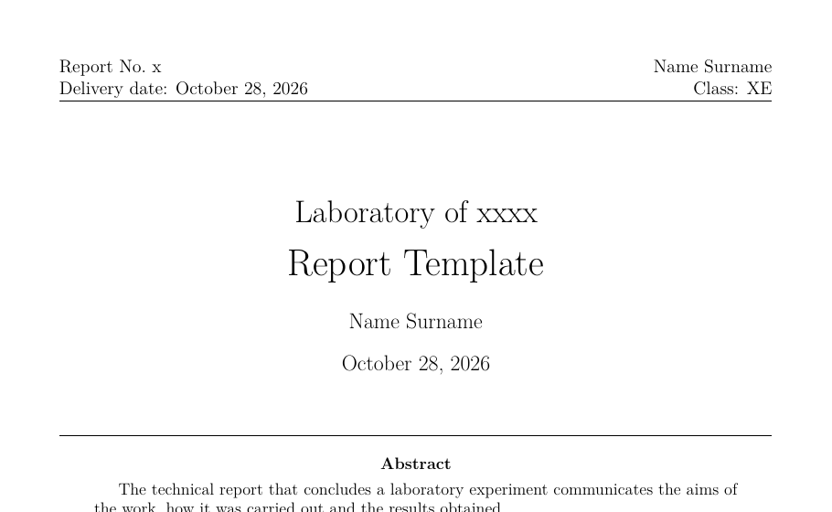
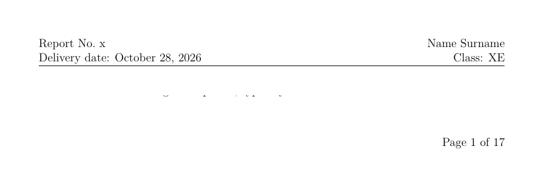
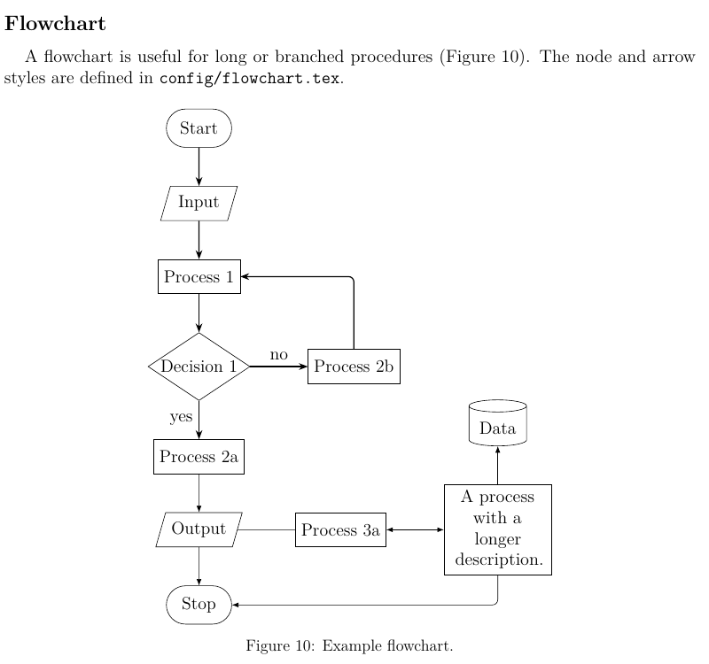
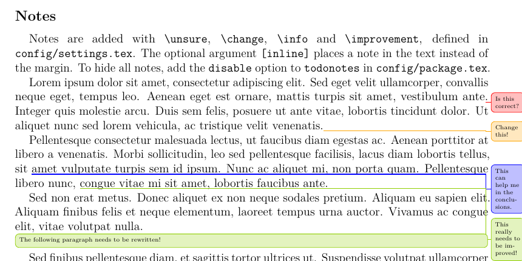

# LaTeX Scientific Report Template

<p align="center">
  <a href="https://github.com/MGriot/LaTeX-Scientific-Report-Template/releases"></a>
  <a href="https://github.com/MGriot/LaTeX-Scientific-Report-Template/graphs/contributors"></a>
  <a href="https://github.com/MGriot/LaTeX-Scientific-Report-Template/releases/latest"></a>
  <a href="https://github.com/MGriot/LaTeX-Scientific-Report-Template"></a>
  <a href="https://github.com/MGriot/LaTeX-Scientific-Report-Template/issues"></a>
  <a href="https://github.com/MGriot/LaTeX-Scientific-Report-Template/blob/master/LICENSE"></a>
</p>

A LaTeX template for **laboratory reports**, designed for chemistry but easy to adapt to any experimental subject. It gives you a clean title block, a header and footer with report data, a section skeleton that explains what to write in each part, and ready-made tools for chemical formulae, safety data, units, plots and flowcharts.

📄 **[See the compiled example PDF](.out/main.pdf)**

<p align="center">
  
  
</p>

> This guide explains how to use the template; it assumes basic LaTeX knowledge. New to LaTeX? Start with [Learn LaTeX in 30 minutes](https://www.overleaf.com/learn/latex/Learn_LaTeX_in_30_minutes).

## Contents

- [Features](#features)
- [Quick start](#quick-start)
- [Project structure](#project-structure)
- [Configuration](#configuration)
- [Writing the report](#writing-the-report)
- [Chemistry and safety tools](#chemistry-and-safety-tools)
- [Units, tables, plots and cross-references](#units-tables-plots-and-cross-references)
- [Flowcharts](#flowcharts)
- [Notes and comments](#notes-and-comments)
- [Bibliography](#bibliography)
- [Troubleshooting](#troubleshooting)
- [License](#license)

## Features

- **One place for report data**: author, course, title, report number, class and dates are set once and reused in the title, header, footer and PDF metadata.
- **Guided sections**: Objective, Principle of the method, Instruments, Reagents, Procedure, Reactions, Data and calculations, Conclusions, Bibliography, each with writing tips.
- **Chemistry**: `mhchem` for formulae and equations, `chemfig` for structures, `modiagram` for molecular orbital diagrams.
- **Safety**: every GHS hazard (H), precautionary (P) and EU supplemental (EUH) statement available through `\Hphrase{H314}` / `\Pphrase{P280}`, plus the nine GHS pictograms.
- **Units and numbers** with `siunitx`, decimal-aligned table columns, `booktabs` tables.
- **Plots** with `pgfplots`, from inline coordinates or data files.
- **Flowcharts** with a library of predefined TikZ node and arrow styles.
- **Smart references** with `cleveref` (`\cref{fig:x}` → "Figure 3").
- **Margin notes** (`todonotes`) to mark open points while drafting, removable with one option.
- **ACS citation style** via `biblatex-chem`.
- Clean builds with `latexmk`: auxiliary files go to `.out/`.

## Quick start

### 1. Install a LaTeX distribution

| Option | How |
| --- | --- |
| **Online** | Upload the project to [Overleaf](https://www.overleaf.com/) (*New Project → Upload Project* with the zip). Use compiler pdfLaTeX and main document `main.tex`. If no PDF appears, delete `.latexmkrc` (its output folder setting is meant for local builds). |
| **Windows** | [MiKTeX](https://miktex.org/download) (allow on-the-fly package installation) or [TeX Live](https://tug.org/texlive/). Keep the distribution updated. |
| **macOS** | [MacTeX](https://tug.org/mactex/). |
| **Linux** | TeX Live from your package manager (e.g. `texlive-full`) or from [tug.org](https://tug.org/texlive/). |

A good editor helps: [VS Code](https://code.visualstudio.com/) with [LaTeX Workshop](https://marketplace.visualstudio.com/items?itemName=James-Yu.latex-workshop), [TeXstudio](https://www.texstudio.org/) or [TeXShop](https://pages.uoregon.edu/koch/texshop/) (macOS).

### 2. Get the template

Download the latest [release](https://github.com/MGriot/LaTeX-Scientific-Report-Template/releases), or *Code → Download ZIP*, or clone it:

```bash
git clone https://github.com/MGriot/LaTeX-Scientific-Report-Template.git
```

### 3. Compile

The bibliography is processed by **biber**, so the document needs several passes. `latexmk` does it all, reading the settings in `.latexmkrc`:

```bash
latexmk main.tex
```

The PDF is written to `.out/main.pdf`. To remove auxiliary files run `latexmk -c`.

Without latexmk, run `pdflatex main.tex`, `biber main`, then `pdflatex main.tex` twice (in that case the output stays in the project folder).

## Project structure

```text
.
├── main.tex                     # entry point: loads config, presets and sections
├── .latexmkrc                   # build settings (pdfLaTeX + biber, output in .out/)
├── bibliography.bib             # bibliography database
├── config/
│   ├── package.tex              # packages, in the correct load order
│   ├── settings.tex             # report data, layout, header/footer, custom commands
│   ├── flowchart.tex            # TikZ styles for flowcharts
│   ├── ghs_phrases.tex          # GHS H, P and EUH statements
│   └── preset/                  # alternative title blocks (1a, 2a + 2b)
├── section/
│   ├── 0_abstract.tex
│   ├── 1_objective.tex
│   ├── 2_principle_of_the_method.tex
│   ├── 3_instruments.tex
│   ├── 4_reagents.tex
│   ├── 5_procedure.tex
│   ├── 6_reactions.tex
│   ├── 7_data_and_calculations.tex
│   ├── 8_conclusions.tex
│   ├── 9_bibliography.tex
│   ├── 10_hazard_statements.tex
│   ├── examples.tex             # reference examples: delete in a real report
│   └── useful_links.tex         # reference links: delete in a real report
├── data/                        # data files for plots
└── img/
    ├── pictograms/              # GHS hazard pictograms
    └── GitHub/                  # images used by this README
```

## Configuration

### Report data

Everything that changes from one report to the next is at the top of [`config/settings.tex`](config/settings.tex):

```latex
\newcommand{\authorname}{Name}
\newcommand{\authorsurname}{Surname}
\newcommand{\course}{Laboratory of xxxx}     % subject / course name
\newcommand{\reporttitle}{Report Template}   % title of the experiment
\newcommand{\reportnumber}{x}                % progressive number of the report
\newcommand{\classname}{XE}                  % class, group or course code
\newcommand{\performeddate}{\today}          % date the experiment was performed
\newcommand{\deliverydate}{\today}           % date the report is handed in
```

Write dates explicitly (e.g. `\newcommand{\performeddate}{12 March 2025}`) rather than `\today`, which is the compilation date. To add co-authors, extend `\author`: `\author{\authorname\ \authorsurname \and Jane Doe}`.

These values fill the title, the header (report number, delivery date, author, class), the footer (*Page x of y*) and the PDF properties.

### Title block presets

`main.tex` loads one preset from `config/preset/`:

| Preset | Result |
| --- | --- |
| `preset_1a` (default) | Date the experiment was performed shown under the author. |
| `preset_2a` + `preset_2b` | No date in the title; a small table below it with date performed, partners and instructor. Load `preset_2a` in the preamble and uncomment `\input{config/preset/preset_2b}` right after `\maketitle`. |

### Layout

In [`config/settings.tex`](config/settings.tex):

- **Margins**: `\geometry{a4paper, top=3cm, bottom=3cm, left=1.5cm, right=1.5cm}`.
- **Header and footer**: the `\fancyhead[L]`, `\fancyhead[R]` and `\fancyfoot[R]` lines. An optional footer line with a QR code crediting the template is provided, commented out; enabling it is appreciated but not required.
- **Paragraph indentation**: uncomment `\setlength{\parindent}{0pt}` to remove it.

In [`config/package.tex`](config/package.tex):

- **Font size**: `\usepackage[fontsize=13pt]{scrextend}` accepts any size, unlike the standard 10/11/12pt class options.
- **Language**: `\usepackage[english]{babel}` sets the language of generated text (*Contents*, *Figure*, dates) and hyphenation. Change it to e.g. `italian` or `german` if you write in another language.
- **Indentation of the first paragraph** after a heading: remove `indentfirst` if you prefer the English typographic convention of no indent.

## Writing the report

Each file in `section/` contains a short explanation of what belongs in that section, with examples: replace the explanations with your content. Remove the `\input` line in `main.tex` for any section you don't need, and delete the `useful_links` and `examples` lines before handing in the report.

| Section | Content |
| --- | --- |
| Abstract | Short summary of the experiment, method and main result. |
| Objective | The aim of the experiment in one or two sentences. |
| Principle of the method | The theory needed to understand the experiment. |
| Instruments | Glassware and instruments, with capacity, tolerance and resolution. |
| Reagents | Chemicals with concentration or purity, and their safety data. |
| Procedure | The procedure actually followed, with relevant observations. |
| Reactions | Balanced reactions and mechanisms. |
| Data and calculations | Raw data, formulae with units, calculations, plots. |
| Conclusions | Outcome, comparison with literature values, critical remarks. |
| Bibliography | The sources used. |
| Hazard statements | Full text of the H and P statements cited in the reagent table. |

## Chemistry and safety tools

### Formulae, equations and structures

```latex
\ce{H2SO4}                      % formula
\ce{2 H2O2 -> 2 H2O + O2 ^}     % reaction (^ = gas, v = precipitate)
\ce{H2O <=> H+ + OH-}           % equilibrium
\ce{CuSO4.5H2O}                 % hydrate
\chemfig{*6(-=-=-=)}            % benzene ring
```

See the `mhchem`, `chemfig` and `modiagram` examples in `section/6_reactions.tex` and `section/examples.tex`.

### GHS hazard and precautionary statements

[`config/ghs_phrases.tex`](config/ghs_phrases.tex) contains the official English wording (UN GHS Rev. 10 and EU CLP) of all H statements, P statements (including the common combinations) and EUH statements:

```latex
\Hphrase{H314}            % H314 – Causes severe skin burns and eye damage.
\Pphrase{P305+P351+P338}  % spaces around "+" are optional
\Hphrase{EUH019}
```

An unknown code stops compilation with a clear error. Add a missing statement or override one in the preamble:

```latex
\DeclareGHSPhrase{P221}{Take any precaution to avoid mixing with combustibles.}
```

To change how every statement looks, redefine `\ghsformat`, e.g. `\renewcommand{\ghsformat}[2]{#1: \emph{#2}}`.

### Pictograms

`img/pictograms/` contains the nine GHS pictograms:

| File | Code | File | Code |
| --- | --- | --- | --- |
| `explosive.png` | GHS01 | `acute-toxicity.png` | GHS06 |
| `flammable.png` | GHS02 | `health-hazard.png` | GHS07 |
| `oxidizing.png` | GHS03 | `serious-health-hazard.png` | GHS08 |
| `gas-under-pressure.png` | GHS04 | `hazardous-to-environment.png` | GHS09 |
| `corrosive.png` | GHS05 | | |

`section/4_reagents.tex` shows complete reagent tables with structure, statements, pictograms, PPE and exposure limits.

## Units, tables, plots and cross-references

```latex
\qty{25.00}{\milli\litre}            % quantity with unit
\unit{\mole\per\litre}               % unit only
\num{6.022e23}                       % number
\qty{0.1032(4)}{\mole\per\litre}     % value with uncertainty
```

- **Tables** use `booktabs` rules (`\toprule`, `\midrule`, `\bottomrule`) without vertical lines. The column type `S[table-format=2.2]` from `siunitx` aligns numbers on the decimal point; the custom column `C{3cm}` (defined in `settings.tex`) is a centred, vertically middle-aligned cell, handy for images.
- **Plots** use `pgfplots`; `section/7_data_and_calculations.tex` shows a plot from coordinates and one read from `data/*.txt` with `\addplot table {data/data.txt};`.
- **References**: give every float a `\label` with a prefix (`fig:`, `tab:`, `eq:`) and refer to it with `\cref{fig:solubility}`, which prints "Figure 2" automatically. Use `\Cref` at the beginning of a sentence.

## Flowcharts

Styles defined in [`config/flowchart.tex`](config/flowchart.tex):

| Style | Shape |
| --- | --- |
| `starter`, `terminator`, `terminator_longtext2` | Start / end (rounded) |
| `process`, `process_longtext2`, `process_longtext2.5` | Process (rectangle, optionally fixed width) |
| `decision` | Decision (diamond) |
| `io` | Input / output (parallelogram) |
| `manual_input` | Manual input |
| `document`, `multiple_document` | Document(s) |
| `database` | Stored data (cylinder) |
| `invisible_node` | Invisible point to route lines |
| `arrow_stealth`, `arrow_stealth_rounded`, `double_arrow_stealth` | Arrows with Stealth tips |
| `arrow_latex`, `arrow_latex_rounded`, `double_arrow_latex` | Arrows with LaTeX tips |
| `line_rect`, `line_round`, `line_butt`, `line_rounded_corners`, `line_rounded_corners_dotted` | Plain lines |

```latex
\begin{tikzpicture}[node distance=1cm and 1.5cm]
    \node (start) [starter] {Start};
    \node (step)  [process, below=of start] {Weigh the sample};
    \node (check) [decision, below=of step] {Dry?};
    \node (stop)  [terminator, below=of check] {Stop};
    \draw [arrow_stealth] (start) -- (step);
    \draw [arrow_stealth] (step) -- (check);
    \draw [arrow_stealth] (check) -- node[right] {yes} (stop);
    \draw [arrow_stealth_rounded] (check.east) -- ++(1,0) |- node[near start, right] {no} (step);
\end{tikzpicture}
```

<p align="center"></p>

## Notes and comments

While drafting, mark open points with coloured notes (defined in `config/settings.tex`):

```latex
\unsure{Is this value correct?}        % red
\change{Rephrase this}                 % orange
\info{Source: lab handout, p. 3}       % blue
\improvement{Add an error analysis}    % green
\info[inline]{A note inside the text}  % inline instead of in the margin
\listoftodos                           % list of all notes
```

<p align="center"></p>

To hide all notes in the final PDF without deleting them, add `disable` to the `todonotes` options in `config/package.tex`.

## Bibliography

Add entries to [`bibliography.bib`](bibliography.bib) and cite them with `\autocite{key}`, which produces superscript numbers in the American Chemical Society style (`biblatex` with `style=chem-acs`). Only cited entries appear in the list. Tools such as [doi2bib](https://www.doi2bib.org/) or [Zotero](https://www.zotero.org/) generate BibTeX entries from a DOI.

To use another style, change the `biblatex` options in `config/package.tex`, e.g. `style=numeric-comp` or `style=authoryear`.

## Troubleshooting

| Problem | Solution |
| --- | --- |
| Bibliography empty, citations shown as **[key]** | biber did not run: compile with `latexmk`, or run `biber main` between two `pdflatex` runs. On Overleaf, use *Recompile from scratch*. |
| `File 'xxx.sty' not found` | Install the missing package (MiKTeX Console / `tlmgr install xxx`), or install the full distribution. |
| Errors inside `siunitx`, `expl3` or other LaTeX3 packages (e.g. `Undefined control sequence ... siunitx_print`) | Packages and LaTeX kernel are out of sync: update the whole distribution (MiKTeX Console → *Updates*, or `tlmgr update --all`). |
| `Unknown GHS statement code` | Check the code, or add it with `\DeclareGHSPhrase`. |
| `Package fancyhdr Warning: \headheight is too small` | Increase `\headheight` in `settings.tex` (needed with bigger fonts or more header lines). |
| Images not found | Paths are relative to `main.tex`; avoid spaces in file names. |

## License

Released under the [GPL-3.0 License](LICENSE). If you use this template, a mention of the [repository](https://github.com/MGriot/LaTeX-Scientific-Report-Template) or of its author is appreciated but not required.
